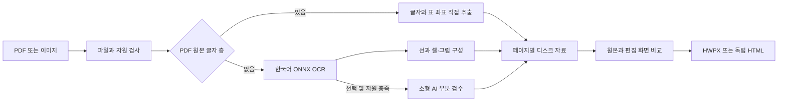

# 스캔노트 구조

스캔노트는 Windows 실행 파일 또는 Python에서 루프백 FastAPI 서버를 시작하고, 외부 CDN 없이 브라우저 편집 화면을 제공합니다. 입력을 페이지별로 처리해 원본 좌표를 가진 편집 자료를 만들고 HWPX 또는 독립 HTML로 내보냅니다.

PDFium이 PDF 렌더링과 원본 글자 정보를 제공합니다. 스캔 OCR은 RapidOCR와 ONNX Runtime CPU를 사용합니다. 대형 이미지 디코딩은 분리된 작업 프로세스와 libvips를 사용하며 분할 이미지의 좌표를 원본 공간으로 되돌립니다. API 모드의 이미지 전송과 축소는 별도 경로입니다.

최대 입력은 1 GiB, 500쪽입니다. 자원 계획은 가용 메모리에서 여유를 남기고 8 GiB까지 사용량을 계획합니다. 메모리 조회 실패 시 2 GiB 기준으로 계획합니다. OCR 스레드는 최대 4개, 인식 배치는 4개이며 문서는 한 쪽씩 처리합니다. 계획과 이미지 분할은 자원을 줄이는 장치이며 모든 입력의 운영체제 메모리 상한을 보증하지 않습니다.

페이지별 편집 자료와 그림은 디스크에 보관합니다. 내보내기는 ZIP/HTML에 순차 기록하고 다운로드는 서버의 결과 파일을 직접 제공합니다. 페이지 수가 많아도 출력 형식별 결과 파일은 하나입니다. 브라우저의 화면 편집량과 저장 공간은 입력에 따라 늘어납니다.

완료 페이지 JSON은 원자적으로 교체하고 메모리에서 방출합니다. 진행 조회는 상태만 반환하며 화면은 페이지 단위로 읽고, 수정하지 않은 먼 페이지를 비웁니다. 중단한 작업은 원본 SHA256·처리 버전·페이지 및 이미지 자료를 검증한 뒤 완료 페이지를 재사용합니다. 변환·AI 준비·저장·품질 측정은 하나의 자원 입장 제어를 공유합니다. 현재 앱과 소유 자식의 private commit·working set을 측정하며 브라우저를 합산하지 않습니다. 예측 예산과 자식의 강제 commit 제한은 다른 범위입니다.

소형 AI는 한국어 OCR의 좌표·표·그림을 유지하면서 어려운 글자 최대 2줄만 검수합니다. 제안은 원문·숫자·좌표에 자동 적용하지 않습니다. 자원이 부족하거나 모델 응답이 실패하면 기본 OCR 결과를 보존합니다. 모델 프로세스는 앱이 소유하고 종료·유휴 처리 시 정리합니다.

API 키는 화면과 요청 메모리에만 보관합니다. 외부 Origin의 쓰기를 제한하고, 내보내기 그림 경로를 해당 작업 안으로 검사합니다. HTML/XML 특수문자는 이스케이프하며 페이지 문구를 실행 명령으로 사용하지 않습니다. 로컬 작업 자료는 종료 후 남을 수 있습니다.

공개 품질 평가와 한계는 [공개 검증 기록](VALIDATION_PUBLIC.md)에 있습니다. 실행 파일의 빌드 manifest는 소스와 실행 파일 해시를 기록하고, 패키징 시 최종 소스와 일치하는지 확인합니다.
